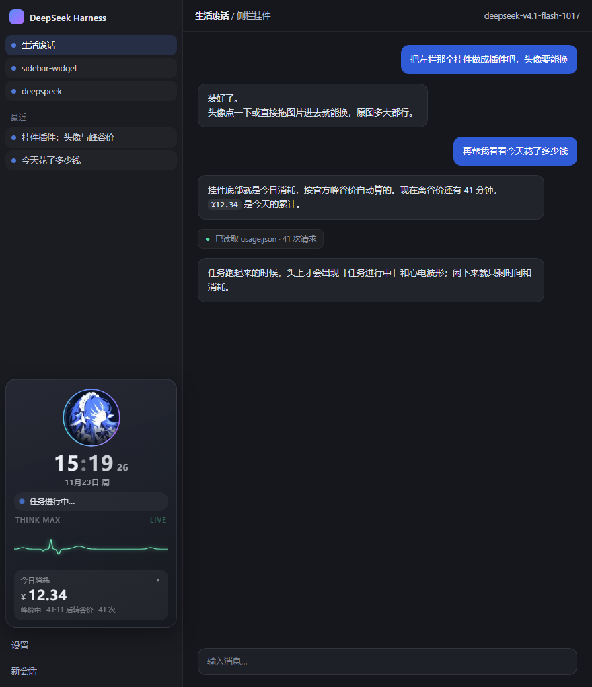
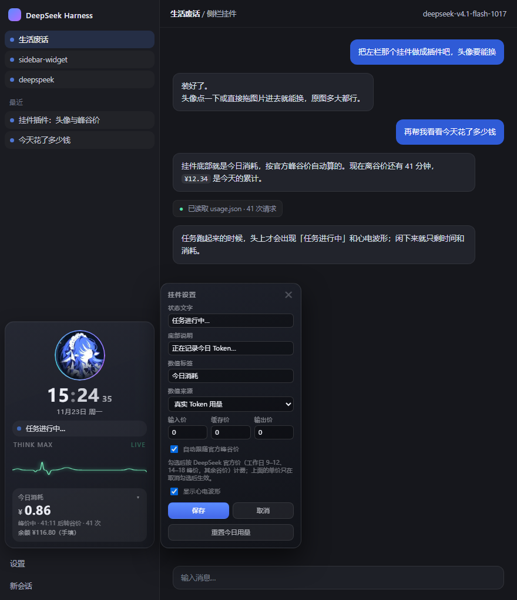

# 侧栏挂件 · dsh-sidebar-widget

给 DSH 左侧栏加一张小卡片：头像、时钟、任务状态、**今天花了多少钱**，还有峰谷价倒计时。



不用开别的窗口——干活的时候瞄一眼侧栏，就知道这一轮任务是不是还在跑、今天消耗到多少、离谷价还有多久。

## 这张卡片能做什么

- **时钟**：大号时分，秒数跟在后面；下面是「11月23日 周一」。
- **头像**：点一下或把图片拖进去就能换，**原图多大都行**（不压缩、不缩限，只在显示时圆形裁切）。
- **任务状态**：「任务进行中…」+ 心电波形**只在真的有任务在跑时出现**，闲下来自动消失。
- **今日消耗**：当天累计花费，按 DeepSeek 官方峰谷价自动计价；下面一行小字告诉你现在是峰价还是谷价、还有多久切换。
- **余额**：配了 DeepSeek API Key 就显示官方账户余额，没有就用手填的数字（标「手填」）。
- **右键卡片**：改状态文字、底部说明、数值标签、计价方式，或者把今天的用量清零。



卡片上的数字都来自 DSH 自己记录的每次请求用量（输入 / 缓存命中 / 输出），不是估算。

## 安装

需要 DSH 桌面版。装完**重启 DSH**，卡片出现在左侧栏最下方、设置按钮上面。

```bash
# 直接从 GitHub 装（推荐，无需 npm 账号）
dsh plugin --profile desktop add https://codeload.github.com/superaleiasia/dsh-sidebar-widget/tar.gz/refs/heads/main

# 本机目录安装（改代码时用）
dsh plugin --profile desktop add link:F:\\path\\to\\dsh-sidebar-widget
```

仓库更新后，重跑同一条命令就是升级。

如果手里没有 `dsh` 命令，手动安装等价于三件事：

1. `~/.dsh/profiles/<profile>/package.json` 的 `dependencies` 加 `"dsh-sidebar-widget": "https://codeload.github.com/superaleiasia/dsh-sidebar-widget/tar.gz/refs/heads/main"`
2. 同一文件 `dsh.profile.bundles` 数组里加 `"dsh-sidebar-widget"`
3. 在 profile 目录跑 `pnpm install`，再在 `cordis.patch.yml` 末尾加：

```yaml
- insert:
    - id: dsh-sidebar-widget
      name: dsh-sidebar-widget
```

## 换头像

点头像选图，或者直接把图片拖到卡片上。支持 png / jpg / gif / webp / avif / bmp / svg，单张最大 64 MB。

原图存在 `~/.dsh/sidebar-widget/avatar.<扩展名>`，想换回来随时再点一次；设置面板里的按钮不会动头像。

## 右键设置

| 字段 | 作用 |
| --- | --- |
| 状态文字 | 蓝点后面那句话，默认「任务进行中…」 |
| 底部说明 | 还没有用量时显示的文案 |
| 数值标签 | 金额上方的小标题，默认「今日消耗」 |
| 数值来源 | 真实 Token 用量 / 手填余额 |
| 自动跟随官方峰谷价 | 默认开；关掉后才用下面三个单价 |
| 输入 / 缓存 / 输出价 | ¥ 每百万 token，按需手填 |
| 显示心电波形 | 不喜欢动的可以关掉 |
| 重置今日用量 | 把当天累计清零 |

保存立即生效，写在 `~/.dsh/sidebar-widget/config.json`，也可以直接改这个文件（60 秒内自动读到）。

## 今日消耗怎么算

- 时段：**工作日 9:00–12:00、14:00–18:00 为峰价**，其余时段、周末和法定节假日为谷价，峰价 = 谷价 × 2。
- 价目：Flash 档 缓存 0.02 / 0.04、输入 1 / 2、输出 4 / 8；Pro 档 0.15 / 0.3、4.5 / 9、13.5 / 27（谷 / 峰，¥ 每百万 token）。
- 每次请求结束时按当时的档位累加，改价不回溯，只影响之后的用量。
- 卡片上的倒计时显示「峰价中 · 41:11 后转谷价」这样的剩余时间。
- 用量按自然日归零，存在 `~/.dsh/sidebar-widget/usage.json`。

价格以 [DeepSeek 官方文档](https://api-docs.deepseek.com/zh-cn/quick_start/pricing) 为准；法定节假日表每年 11 月按国务院安排更新一次。

## 常见问题

**卡片没出现？**
确认 DSH 已经重启过；侧栏被拖得很窄（小于 150px，只剩图标）时会自动隐藏。仍没有的话看 `~/.dsh/sidebar-widget/boot.log`，启动和路由注册都有记录。

**任务在跑，但没有「任务进行中」？**
状态只跟着 DSH 的 turn 事件走，得是当前 DSH 里真的在跑任务；第三方终端里跑的进程它看不见。

**金额一直是 0？**
今天还没有产生请求，或者用的是手填模式但没填数字。

**只有时间，没有波形和日期？**
侧栏高度不够时卡片会自动进入紧凑模式，只留最要紧的信息；把窗口拉高就回来。

**余额显示「手填」？**
DSH 里没有 `DEEPSEEK_API_KEY` 凭据时不会去调官方余额接口，用设置里填的数字兜底。

## 卸载

```bash
dsh plugin --profile desktop remove dsh-sidebar-widget
```

手动装的话，把上文三处改动删掉即可。数据留在 `~/.dsh/sidebar-widget/`，不要了可以直接删。

## 许可

MIT © 2026 superaleiasia
